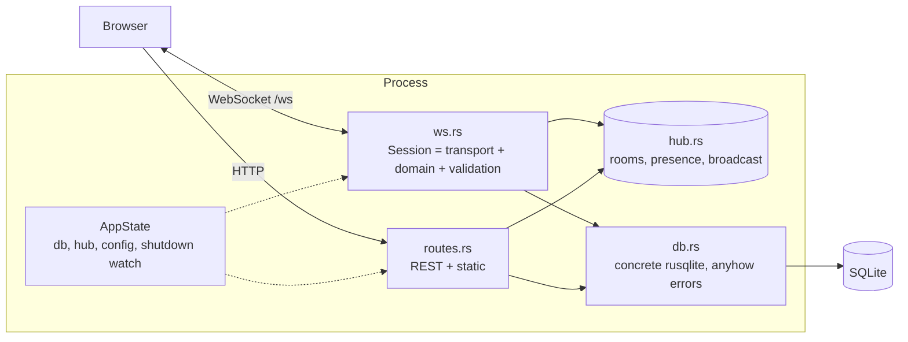
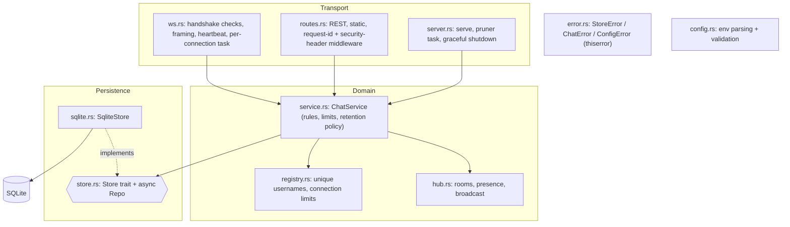

# RustChat architecture review (v1.0.0 -> v1.1.0)

Scope: whole codebase at tag `v1.0.0` (about 900 lines of Rust, 21 tests). The goal was a pragmatic,
portfolio-scale review: fix what is genuinely wrong or risky, document the rest, add no infrastructure
that the project does not need.

## 1. Architecture at v1.0.0

Problems visible in the diagram: `Session` (transport) held the domain rules and called the concrete `Db`
directly; there was no seam between "chat rules" and "how bytes move" or "where data lives".

### Target (v1.1.0)

Dependency direction: transport -> domain -> persistence trait. Nothing in `service`, `hub` or `store`
knows about axum or WebSockets, and nothing outside `sqlite.rs` knows about rusqlite (except the typed
`StoreError` variant that wraps its error).

## 2. Findings

Severity: **High** = security or data-integrity problem, or likely to hurt in normal use. **Medium** =
robustness/maintainability issue with a realistic trigger. **Low** = polish or accepted trade-off.

| ID | Sev | Issue | Why it matters | Fix | Status |
| --- | --- | --- | --- | --- | --- |
| A-01 | High | Usernames not unique: two connections as "alice" are merged in presence and can impersonate each other. Names are also case-sensitive and nothing is reserved ("admin", "system"). | Impersonation inside a room is trivial; presence lists lie. | `Registry::admit` claims a name atomically (case-insensitive), configurable reserved list, RAII `ConnGuard` releases it on every exit path. Rejection is an `error` frame (`username_taken` / `username_reserved`) plus close code 4009. | Fixed |
| A-02 | High | No WebSocket `Origin` check. | Cross-site WebSocket hijacking: any web page the user visits can open a socket to a locally or internally hosted RustChat and act as them. | Same-origin always allowed, extra origins via `ALLOWED_ORIGINS`, `*` to opt out, no `Origin` (CLI clients) allowed; others get HTTP 403 before the upgrade. | Fixed |
| A-03 | High | Unbounded database growth: messages never pruned, rooms never deleted, anyone can create unlimited rooms. | Disk exhaustion by a single misbehaving or malicious client; history queries slow down over time. | Background pruner (`RETENTION_DAYS`, `MAX_MESSAGES_PER_ROOM` default 10000, `ROOM_TTL_DAYS` default 7 for idle non-default rooms), `MAX_ROOMS` cap enforced atomically in the store, empty in-memory rooms dropped from the hub. | Fixed |
| A-04 | High | No authentication. | Anyone who can reach the port can use any free name. | Not added. A-01 closes the impersonation hole for live sessions; real accounts need a user table, credential storage and session tokens, which is a product decision, not an architecture repair. | Left (documented) |
| B-01 | Medium | Slow consumer handling: `Lagged` was only logged; the client silently lost messages and never knew. | Chat history on screen diverges from the truth with no signal. | Forwarder emits a `lagged {room, skipped}` frame; the web client re-joins the room to receive a fresh snapshot. Unit-tested with a deliberately overrun channel. | Fixed |
| B-02 | Medium | Dead or stalled sockets: no write timeout and no heartbeat, so a half-open TCP connection holds its session, presence entry and (now) username indefinitely, and a stuck writer blocks forwarders. | Ghost users, leaked tasks, a name that can never be re-used after a network drop. | 10 s write timeout; server pings every `IDLE_TIMEOUT_SECS/3` and drops silent peers; session also ends when the writer task dies. | Fixed |
| B-03 | Medium | Task lifetime: forwarder tasks were aborted by hand in a few places; the writer could be left detached; a panic or early return skipped cleanup. | Task and memory leaks on unusual disconnect paths. | `AbortOnDrop` wrapper for every forwarder; writer awaited with a timeout then aborted; all sender clones dropped before waiting. | Fixed |
| B-04 | Medium | Persistence coupled to a concrete `Db` with `anyhow` errors; no seam for tests or another backend. | Cannot unit-test domain logic without SQLite; cannot test storage failure paths; errors lose type information. | `Store` trait (sync) + `Repo` async facade running on the blocking pool; `SqliteStore` implements it; tests use a `BrokenStore` to prove failures become typed errors. | Fixed |
| B-05 | Medium | Layering: `Session` in `ws.rs` contained domain rules, DB calls and broadcast logic. | Rules can only be tested through a socket; transport changes risk domain regressions. | `ChatService` owns rules (join/post/leave/create/history/prune); `ws.rs` only translates frames. | Fixed |
| B-06 | Medium | Error handling: `anyhow` in the library, `unwrap()` on mutex locks, `unwrap_or_default()` hiding DB failures on the room list, `expect` on the SIGTERM handler, validation errors as `String`. | A poisoned lock or DB error panicked or silently lied; clients got inconsistent error text. | `thiserror` enums (`StoreError`, `ChatError`, `ConfigError`, `AppError`); poisoned std locks are recovered; no `unwrap`/`expect` on runtime paths; every error frame has a stable `code`; internal details are logged, never sent. | Fixed |
| B-07 | Medium | Config: garbage values silently fell back to defaults (`MAX_MESSAGE_LEN=abc` ran with 2000); no range checks (a refill rate of 0 or a frame limit smaller than a message was accepted). | Operators think they configured something that is not in effect; some values break invariants. | Parse errors and out-of-range values fail startup with a readable message; cross-field checks (frame size must fit a full message, retention >= history limit). | Fixed |
| B-08 | Medium | Frame limit hard-coded; no cap on concurrent connections, per-IP connections or joined rooms. Per-connection rate limiting is bypassed by reconnecting. | Memory/CPU exhaustion by opening many sockets. | `MAX_FRAME_BYTES`, `MAX_CONNECTIONS`, `MAX_CONNECTIONS_PER_IP`, `MAX_JOINED_ROOMS`, all validated. | Fixed |
| B-09 | Medium | Shutdown: signal future inlined in `main`, drain unbounded, shutdown flag only reachable through `AppState`; the real wiring was untestable. | A single stuck connection could hang shutdown forever. | `server::run(listener, state, shutdown_future)` is what `main` calls; tests inject a oneshot instead of Ctrl+C and assert connections close and `run` returns; drain bounded by `SHUTDOWN_GRACE_SECS`; pruner stops on the same signal. | Fixed (see C-01) |
| B-10 | Medium | Observability: only ad-hoc log lines; no way to correlate a WebSocket session with its HTTP request. | Hard to debug a specific user's problem. | Middleware assigns/echoes `X-Request-Id`, wraps requests in a `http` span; each socket runs inside a `conn{id,user,ip,request_id}` span; `/api/health` now reports DB status (503 when degraded) and connection count. | Fixed |
| B-11 | Medium | Static client served without CSP or hardening headers. | Defence in depth against XSS (usernames and messages are rendered with `textContent`, so none known). | CSP pinning the single inline script by hash (test fails if `index.html` drifts), `nosniff`, `X-Frame-Options`, `Referrer-Policy`; `.gitattributes` keeps line endings stable so the hash is too. | Fixed |
| C-01 | Low | The OS-signal wrapper (`os_shutdown_signal`) itself is not exercised by automated tests. | A typo there would only show in production. | Kept tiny and logged on registration failure; the graceful path behind it is tested. A real-signal test needs a child process and platform-specific signalling. | Left |
| C-02 | Low | Single node: presence, broadcast and username registry live in process memory. | Cannot scale horizontally. | Scale-out path (not implemented): move fan-out to Redis pub/sub or NATS, back `Registry` with a TTL'd key (`SET name NX EX`), share SQLite -> Postgres through a second `Store` impl. The `Store` trait and `ChatService` boundary are where those seams go. | Left (documented) |
| C-03 | Low | Message ids are assigned by the DB but broadcast after `await`, so two concurrent senders in one room can be delivered out of id order. | Cosmetic; clients do not rely on order across senders. | Not fixed; would need a per-room sequencer. | Left |
| C-04 | Low | Join race: a message sent between subscribing and loading history appears twice. | Duplicate line on screen. | Intentional (at-least-once beats losing a message); the web client de-duplicates by id. | Left |
| C-05 | Low | Per-IP limit uses the socket peer address; behind a reverse proxy every client shares the proxy's IP. | Limit could be too strict or useless behind a proxy. | Documented in the README; trusting `X-Forwarded-For` safely needs a configured proxy list. | Left |
| C-06 | Low | Single SQLite connection behind a mutex. | Serialises DB access. | Fine at this scale (WAL mode, short statements, blocking pool); a pool belongs with a Postgres `Store`. | Left |

## 3. Decisions

### Changed

- **Introduced a service layer and a repository trait.** This was the structural fix; most other items
  became small once the seams existed. `Store` is deliberately synchronous: rusqlite is, and `Repo` is the
  single place that bridges to async through `spawn_blocking`. A different backend implements one trait.
- **Unique usernames are server-wide and case-insensitive, rejected rather than suffixed.** Auto-suffixing
  ("alice-2") surprises users and makes impersonation of the original harder to notice. The rejection
  happens after the WebSocket upgrade so browsers can read the reason (a pre-upgrade 409 is invisible to
  `WebSocket` clients); the web client returns to the login form with the message. If a client had been
  online and merely reconnects while its previous session lingers, it keeps retrying with backoff; the
  heartbeat clears the ghost within `IDLE_TIMEOUT_SECS`.
- **Retention is a policy evaluated by a background task**, with per-room count cap on by default (10000),
  age limit opt-in, and idle-room expiry (7 days) that never touches default rooms or rooms with people in
  them. `insert_message` refuses to write into a room that was just deleted.
- **Protocol changes are additive.** New: `lagged` server frame; `code` field on `error` frames; close code
  4009 for rejected names. Existing frames and fields are unchanged, and v1.0.0 clients keep working
  (they ignore unknown frames and fields). One behavioural change: a second connection with a name already
  in use is now refused.
- **Config now fails fast** instead of silently defaulting.
- Defaults were chosen to keep the zero-config experience: everything new has a safe default.

### Intentionally left

- **Authentication / accounts** (A-04): out of scope for an architecture repair; documented as a known limitation.
- **Clustering, Redis, message queues:** not justified at this scale; the scale-out path is written down (C-02).
- **Per-room message sequencing, proxy-aware client IPs, SQLite pool** (C-03, C-05, C-06): low value for the cost.
- **Real-signal shutdown test** (C-01): see above.
- **Rate limiting remains per connection**, now bounded by connection caps. A per-user or per-IP token bucket would
  be the next step if abuse appears.

## 4. Verification

Every fix has a test: unique/reserved usernames and release on disconnect (unit + integration), origin
rules (unit + integration 403/same-origin/allow-list), frame limit, connection/room/join caps, pruning by
count, age and idle room (store, service and background-task level), lagged consumer, forwarder
cancellation, heartbeat dropping a silent peer, typed storage failures through a failing `Store`,
config validation, CSP hash, request-id echo, and `server::run` graceful shutdown.
