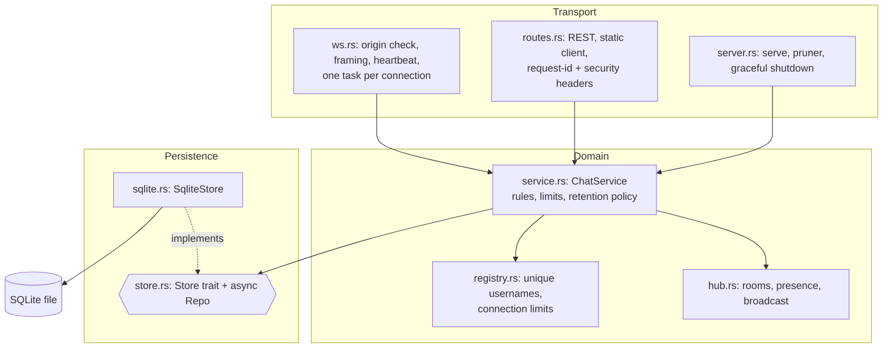

# RustChat

A real-time chat server written in Rust, with a polished zero-build web client served by the same binary.

Built with [axum](https://github.com/tokio-rs/axum) + [tokio](https://tokio.rs), SQLite (`rusqlite`, bundled) for message history, and plain HTML/CSS/JS for the UI.

## Features

- Multiple chat rooms: create, join and leave at runtime
- WebSocket messaging with per-room `tokio::sync::broadcast` channels
- Online presence list per room, typing indicators, join/leave system messages
- Message history persisted in SQLite; the last 50 messages are replayed on join and older ones load on demand ("Load earlier messages")
- REST API: health check, room list (with online counts), room history
- Unique, case-insensitive usernames with a reserved list; WebSocket Origin check; connection, room and frame-size limits
- Per-connection token-bucket rate limiting and message length / name validation
- Configurable message retention (per-room cap, age) and idle-room expiry
- Slow-consumer handling (`lagged` resync), heartbeat that drops dead connections
- Graceful shutdown (Ctrl+C / SIGTERM closes WebSockets cleanly), structured logging with `tracing`
- Configuration through environment variables
- Web client: room sidebar, avatars with initials, timestamps and day separators, auto-scroll with a "new messages" jump button, automatic reconnect with backoff, light/dark theme (follows the OS, switchable), responsive down to phone width, keyboard accessible with visible focus styles and ARIA labels
- The static client is embedded into the binary (`include_str!`), so the release executable is a single file

## Architecture

Layered, with dependencies pointing downwards only. Full review and rationale: [ARCHITECTURE_REVIEW.md](ARCHITECTURE_REVIEW.md).



- **Transport** translates bytes to domain calls and back; it owns handshake checks (Origin, username, admission), the 16 KiB frame limit, a write timeout and a ping/idle heartbeat. Each connection is one task plus a writer task; per-room forwarder tasks are aborted automatically when the session ends.
- **Domain** (`ChatService`, `Hub`, `Registry`) holds the rules and never touches axum or SQLite. Locks are `std::sync::Mutex` and are never held across an `.await`.
- **Persistence** is the `Store` trait. `Repo` runs it on tokio's blocking pool, so swapping SQLite for another backend (or a fake in tests) means implementing one trait.
- **Errors** are typed (`thiserror`): `StoreError`, `ChatError` (carries a stable `code` sent to clients; internal details are logged, not leaked), `ConfigError`.
- **Slow clients:** each room has a bounded broadcast buffer. A client that falls behind receives a `lagged` frame and re-joins to resync; a client whose socket stops draining is dropped.
- **Retention:** a background task prunes by message count (default 10,000 per room), optionally by age, and expires idle non-default rooms.
- **Scale-out path** (not implemented): move fan-out to Redis/NATS pub/sub, put the username claim in a shared store with a TTL, and add a Postgres `Store`.

## Run

Requires a recent stable Rust toolchain (edition 2024) and, on Windows, the MSVC build tools (SQLite is compiled from source via the `bundled` feature).

```powershell
cargo run --release
# then open http://127.0.0.1:3000
```

### Configuration

| Variable | Default | Description |
| --- | --- | --- |
| `HOST` | `127.0.0.1` | Bind address (use `0.0.0.0` to expose on the network) |
| `PORT` | `3000` | TCP port |
| `DB_PATH` | `rustchat.db` | SQLite file (`:memory:` for ephemeral) |
| `MAX_MESSAGE_LEN` | `2000` | Max characters per message (1-10000) |
| `MAX_FRAME_BYTES` | `16384` | Max WebSocket frame/message size; must fit a full message |
| `RATE_CAPACITY` | `10` | Token bucket burst size per connection |
| `RATE_REFILL_PER_SEC` | `3` | Token bucket refill rate |
| `HISTORY_LIMIT` | `50` | Messages replayed on join / default REST limit (1-200) |
| `ALLOWED_ORIGINS` | *(empty)* | Extra allowed WebSocket `Origin`s, comma separated (`https://app.example`); `*` allows any. Same-origin and clients without an `Origin` header are always allowed |
| `RESERVED_USERNAMES` | `system,admin,administrator,server,root,moderator` | Names nobody may take (case-insensitive) |
| `MAX_CONNECTIONS` | `1000` | Concurrent connections |
| `MAX_CONNECTIONS_PER_IP` | `20` | Per peer address (behind a reverse proxy all clients share the proxy's address) |
| `MAX_ROOMS` | `200` | Total rooms |
| `MAX_JOINED_ROOMS` | `20` | Rooms one connection may be in |
| `BROADCAST_CAPACITY` | `256` | Per-room buffer; slower consumers get a `lagged` frame |
| `IDLE_TIMEOUT_SECS` | `90` | Silent connections are dropped (pings every third of this) |
| `MAX_MESSAGES_PER_ROOM` | `10000` | Keep the newest N messages per room (`0` = unlimited) |
| `RETENTION_DAYS` | `0` | Delete messages older than this (`0` = keep) |
| `ROOM_TTL_DAYS` | `7` | Delete idle non-default rooms after this many days (`0` = never) |
| `PRUNE_INTERVAL_SECS` | `300` | How often retention runs |
| `SHUTDOWN_GRACE_SECS` | `10` | Max wait for connections to drain on shutdown |
| `RUST_LOG` | `info` | Log filter (e.g. `rustchat=debug`) |

Invalid or out-of-range values stop the server at startup with an explanatory message instead of being silently ignored.

### Demo client

```powershell
cargo run --example demo_client -- 127.0.0.1:3000 ferris general "Hello!"
```

## Test

```powershell
cargo test            # unit tests + integration tests (real WebSocket clients)
cargo clippy --all-targets
```

## REST API

| Method & path | Description |
| --- | --- |
| `GET /api/health` | `{"status":"ok","version":"1.2.0","connections":0}`; `503` with `"status":"degraded"` if the database is unreachable |
| `GET /api/rooms` | `{"rooms":[{"name":"general","users":2}, ...]}` |
| `GET /api/rooms/:room/messages?limit=50&before=<id>` | `{"room":"general","messages":[...],"has_more":true}` oldest first, `limit` 1-200; `before` returns the page older than that message id; 404 for unknown rooms |

## WebSocket protocol

Connect to `ws://HOST:PORT/ws?username=NAME` (1-24 chars of letters, digits, `_`, `-`, `.`; invalid names get HTTP 400). Usernames are unique across the server, case-insensitively: a name already in use or reserved gets an `error` frame (`username_taken` / `username_reserved`) and the socket is closed with code 4009. Browsers whose `Origin` is not same-origin or allow-listed get HTTP 403. All frames are JSON text with a `type` field. Room names are lowercase `[a-z0-9_-]{1,32}`. `ts` is Unix time in milliseconds.

### Client to server

```json
{"type":"join","room":"general"}
{"type":"leave","room":"general"}
{"type":"message","room":"general","text":"hello"}
{"type":"typing","room":"general","typing":true}
{"type":"create_room","room":"my-room"}
{"type":"list_rooms"}
```

### Server to client

```json
{"type":"welcome","username":"alice","rooms":[{"name":"general","users":0}]}
{"type":"rooms","rooms":[{"name":"general","users":1}]}
{"type":"joined","room":"general","users":["alice"],"has_more":false,"history":[{"id":1,"room":"general","user":"bob","text":"hi","ts":1700000000000}]}
{"type":"left","room":"general"}
{"type":"message","id":2,"room":"general","user":"alice","text":"hello","ts":1700000001000}
{"type":"system","room":"general","text":"alice joined the room","ts":1700000001000}
{"type":"presence","room":"general","users":["alice","bob"]}
{"type":"typing","room":"general","user":"bob","typing":true}
{"type":"error","message":"rate limit exceeded, slow down","code":"rate_limited"}
{"type":"lagged","room":"general","skipped":12}
```

Notes: error `code` values: `invalid`, `room_not_found`, `not_in_room`, `username_taken`, `username_reserved`, `room_limit`, `join_limit`, `server_full`, `too_many_connections`, `rate_limited`, `internal`. `lagged` means this connection fell behind and `skipped` messages were dropped for it; send `join` for that room again to receive a fresh snapshot (the web client does this). `joined` is always delivered before any live traffic for that room. Typing frames dropped by the rate limiter are discarded silently; other rejected frames produce an `error`. Frames larger than `MAX_FRAME_BYTES` close the connection. Every response carries an `X-Request-Id` (a caller-supplied one is echoed).

## Project layout

```
src/main.rs       entry point: tracing, config, run
src/lib.rs        AppState, shutdown signal
src/server.rs     serve, background pruner, graceful shutdown
src/routes.rs     REST + static routes, request-id/security middleware
src/ws.rs         WebSocket transport (origin check, framing, heartbeat, session)
src/service.rs    ChatService: domain rules and retention policy
src/hub.rs        rooms, presence, broadcast channels
src/registry.rs   unique usernames, connection limits
src/store.rs      Store trait + async Repo facade
src/sqlite.rs     SQLite implementation of Store
src/error.rs      typed errors (thiserror)
src/config.rs     env configuration + validation
src/protocol.rs   message types and validation
src/ratelimit.rs  token bucket
static/           web client (index.html, style.css, app.js)
tests/            integration tests
examples/         demo_client
```

## Known limitations

- No authentication or accounts: usernames are unique among live connections but anyone can claim a free name.
- Single-node only: presence, broadcast and the username registry live in process memory (scale-out path described above).
- Rate limiting is per connection (bounded by the connection caps), not per user or address.
- Shutdown on a real Ctrl+C/SIGTERM is covered by a test of the same code path with an injected signal, not by sending an OS signal.

## License

MIT
