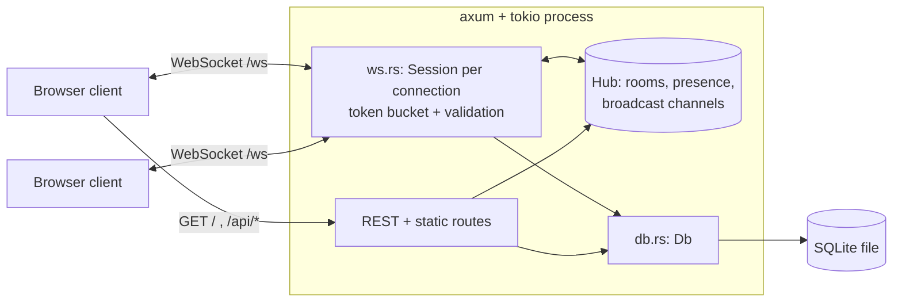

# RustChat

A real-time chat server written in Rust, with a polished zero-build web client served by the same binary.

Built with [axum](https://github.com/tokio-rs/axum) + [tokio](https://tokio.rs), SQLite (`rusqlite`, bundled) for message history, and plain HTML/CSS/JS for the UI.

## Features

- Multiple chat rooms: create, join and leave at runtime
- WebSocket messaging with per-room `tokio::sync::broadcast` channels
- Online presence list per room, typing indicators, join/leave system messages
- Message history persisted in SQLite; the last 50 messages are replayed on join
- REST API: health check, room list (with online counts), room history
- Per-connection token-bucket rate limiting and message length / name validation
- Graceful shutdown (Ctrl+C / SIGTERM closes WebSockets cleanly), structured logging with `tracing`
- Configuration through environment variables
- Web client: room sidebar, avatars with initials, timestamps and day separators, auto-scroll with a "new messages" jump button, automatic reconnect with backoff, light/dark theme (follows the OS, switchable), responsive down to phone width, keyboard accessible with visible focus styles and ARIA labels
- The static client is embedded into the binary (`include_str!`), so the release executable is a single file

## Architecture



Each WebSocket connection owns a `Session`. Joining a room subscribes it to that room's broadcast channel through a small forwarder task that feeds the connection's outgoing queue. Messages are validated, persisted, then broadcast, so every member (including the sender) receives the stored message with its database id and timestamp.

## Run

Requires a recent stable Rust toolchain (edition 2024) and, on Windows, the MSVC build tools (SQLite is compiled from source via the `bundled` feature).

```powershell
cargo run --release
# then open http://127.0.0.1:3000
```

### Configuration

| Variable | Default | Description |
| --- | --- | --- |
| `HOST` | `127.0.0.1` | Bind address (use `0.0.0.0` to expose on the network) |
| `PORT` | `3000` | TCP port |
| `DB_PATH` | `rustchat.db` | SQLite file (`:memory:` for ephemeral) |
| `MAX_MESSAGE_LEN` | `2000` | Max characters per message |
| `RATE_CAPACITY` | `10` | Token bucket burst size per connection |
| `RATE_REFILL_PER_SEC` | `3` | Token bucket refill rate |
| `HISTORY_LIMIT` | `50` | Messages replayed on join / default REST limit |
| `RUST_LOG` | `info` | Log filter (e.g. `rustchat=debug`) |

### Demo client

```powershell
cargo run --example demo_client -- 127.0.0.1:3000 ferris general "Hello!"
```

## Test

```powershell
cargo test            # unit tests + integration tests (two real WebSocket clients)
cargo clippy --all-targets
```

## REST API

| Method & path | Description |
| --- | --- |
| `GET /api/health` | `{"status":"ok","version":"1.0.0"}` |
| `GET /api/rooms` | `{"rooms":[{"name":"general","users":2}, ...]}` |
| `GET /api/rooms/:room/messages?limit=50` | `{"room":"general","messages":[...]}` oldest first, `limit` 1-200; 404 for unknown rooms |

## WebSocket protocol

Connect to `ws://HOST:PORT/ws?username=NAME` (1-24 chars of letters, digits, `_`, `-`, `.`; invalid names get HTTP 400). All frames are JSON text with a `type` field. Room names are lowercase `[a-z0-9_-]{1,32}`. `ts` is Unix time in milliseconds.

### Client to server

```json
{"type":"join","room":"general"}
{"type":"leave","room":"general"}
{"type":"message","room":"general","text":"hello"}
{"type":"typing","room":"general","typing":true}
{"type":"create_room","room":"my-room"}
{"type":"list_rooms"}
```

### Server to client

```json
{"type":"welcome","username":"alice","rooms":[{"name":"general","users":0}]}
{"type":"rooms","rooms":[{"name":"general","users":1}]}
{"type":"joined","room":"general","users":["alice"],"history":[{"id":1,"room":"general","user":"bob","text":"hi","ts":1700000000000}]}
{"type":"left","room":"general"}
{"type":"message","id":2,"room":"general","user":"alice","text":"hello","ts":1700000001000}
{"type":"system","room":"general","text":"alice joined the room","ts":1700000001000}
{"type":"presence","room":"general","users":["alice","bob"]}
{"type":"typing","room":"general","user":"bob","typing":true}
{"type":"error","message":"rate limit exceeded, slow down"}
```

Notes: `joined` is always delivered before any live traffic for that room. Typing frames dropped by the rate limiter are discarded silently; other rejected frames produce an `error`. Frames larger than 16 KiB close the connection.

## Project layout

```
src/main.rs       entry point, tracing, graceful shutdown
src/lib.rs        AppState
src/config.rs     env configuration
src/routes.rs     REST + static asset routes
src/ws.rs         WebSocket sessions
src/hub.rs        rooms, presence, broadcast channels
src/db.rs         SQLite persistence
src/protocol.rs   message types and validation
src/ratelimit.rs  token bucket
static/           web client (index.html, style.css, app.js)
tests/            integration tests
examples/         demo_client
```

## Known limitations

- No authentication: usernames are not reserved, so anyone can use any name.
- Single-node only: presence and broadcast state live in process memory.
- Rooms cannot be deleted and messages are never pruned.

## License

MIT
